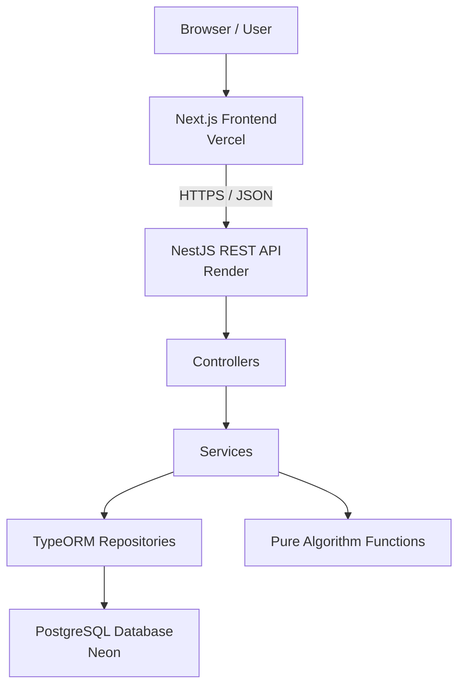
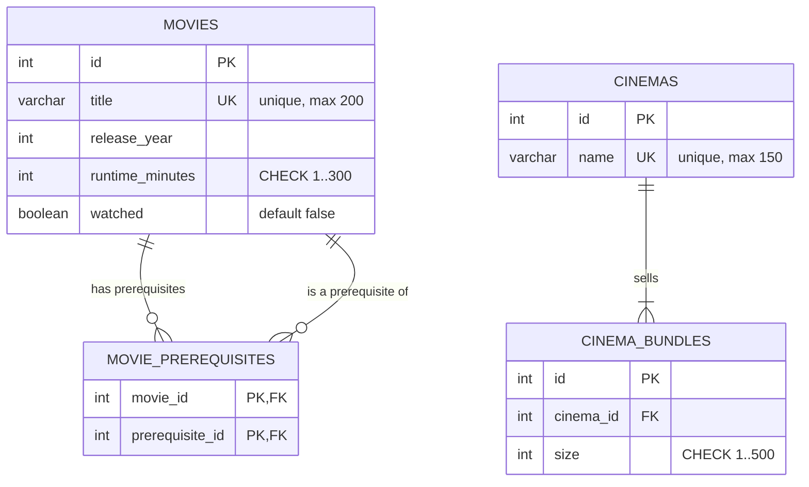
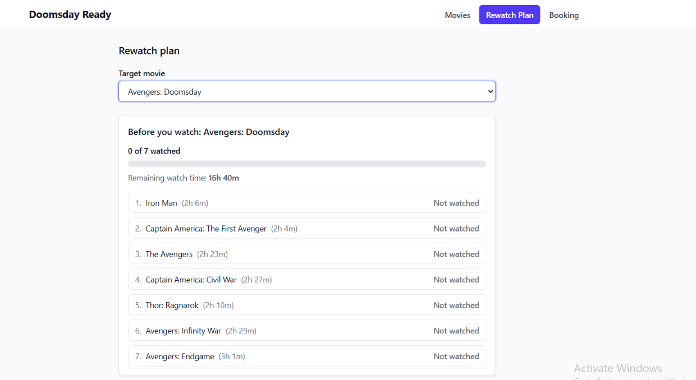
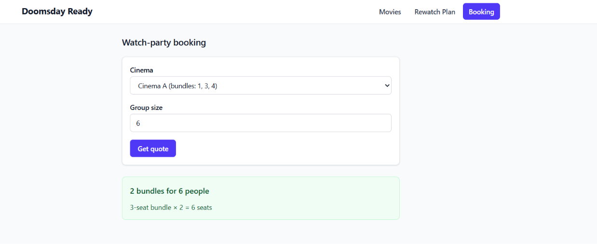

# Doomsday Ready

A full-stack web application that helps Marvel Cinematic Universe (MCU) fans plan their rewatch before *Avengers: Doomsday* and calculate opening-night watch-party ticket bundles.

Built for the **Blinto Talent Accelerator 2027 – Full Stack Developer Internship Assessment**.

| Resource | Link |
|---|---|
| Live frontend | https://doomsday-ready-theta.vercel.app |
| Live backend (API base URL) | https://doomsday-ready-api.onrender.com/api |
| GitHub repository | https://github.com/shafikulnayem10/doomsday-ready |

> **Note on cold starts:** The backend runs on Render's free tier and may spin down after 15 minutes of inactivity. The first request after a pause can take around a minute while the service starts. Neon may also suspend its database compute when idle, causing additional latency on the first database query. If the frontend shows "Loading..." during the first visit, please wait for the services to wake up or open the API URL once.

---

## Table of Contents

1. [Features](#features)
2. [Tech Stack](#tech-stack)
3. [Architecture Overview](#architecture-overview)
4. [Folder Structure](#folder-structure)
5. [Data Model (ER Diagram)](#data-model-er-diagram)
6. [Local Setup](#local-setup)
7. [Environment Variables](#environment-variables)
8. [API Documentation](#api-documentation)
9. [Testing with Thunder Client](#testing-with-thunder-client)
10. [Algorithms and Design Decisions](#algorithms-and-design-decisions)
11. [Assumptions and Limitations](#assumptions-and-limitations)
12. [Problems Faced and Solutions](#problems-faced-and-solutions)
13. [Deployment](#deployment)
14. [Screenshots](#screenshots)
15. [AI Usage Disclosure](#ai-usage-disclosure)

---

## Features

### Movies and Rewatch Order

- Create movies with a unique title, release year, runtime (1–300 minutes), optional prerequisites, and a watched flag (default: `false`).
- Update any movie field, including watched status and prerequisites.
- Circular dependencies (direct or indirect) are rejected with `409 CIRCULAR_DEPENDENCY`. No changes are saved when this happens.
- Generate a rewatch order for a target movie, including every transitive prerequisite exactly once.
- Prerequisite movies always appear before the movies that depend on them.
- The target movie is excluded from the final rewatch list.
- The response includes the number of watched prerequisites and the total remaining runtime of unwatched prerequisites.

### Cinemas and Watch-Party Booking

- Create cinemas with a unique name and 1–10 distinct bundle sizes (each containing 1–500 seats).
- Calculate the minimum number of bundles required to accommodate a group.
- The booking system supports group sizes from 1 to 10,000.
- Returns the quantity of each bundle size needed to reach the exact group size.
- Returns a clear `"Not Possible"` result when no exact combination exists.

### Frontend (Three Main Views)

**Movies**
- View the movie list.
- Add and edit movies.
- Manage prerequisite relationships.
- Mark movies as watched or unwatched.

**Rewatch Plan**
- Select a target movie.
- View the ordered prerequisite list.
- Track watched movies with a progress bar (e.g., "4 of 7 watched").
- See the remaining watch time.

**Booking**
- Select a cinema.
- Enter a group size.
- View the minimum bundle combination required.
- See a "Not possible" result when an exact combination cannot be found.

---

## Tech Stack

| Layer | Technology |
|---|---|
| Backend | NestJS, TypeScript (ESM), REST API |
| Database | PostgreSQL, TypeORM |
| Validation | class-validator, class-transformer, @nestjs/config |
| Frontend | Next.js (App Router), React, TypeScript, Tailwind CSS |
| API Testing | Thunder Client (VS Code Extension), Manual Testing |
| Backend Hosting | Render |
| Database Hosting | Neon |
| Frontend Hosting | Vercel |

---

## Architecture Overview

The application follows a layered backend architecture with a separate frontend and database.



### Architecture Responsibilities

- **Controllers:** Handle HTTP requests, routes, parameters, and DTOs.
- **Services:** Contain business logic and communicate with the database through TypeORM repositories.
- **Repositories:** Handle database operations through TypeORM.
- **Algorithms:** Implemented as independent TypeScript functions (`prerequisite-graph.ts` and `min-bundles.ts`). They receive data as input and return calculated results without directly accessing the database.
- **Global Exception Filter:** Converts application errors into a consistent JSON response format.
- **Global ValidationPipe:** Validates incoming request bodies and query parameters using DTO classes.

This separation keeps business logic independent of HTTP handling and database operations.

---

## Folder Structure

```text
doomsday-ready/
│
├── backend/
│   ├── .env.example
│   └── src/
│       ├── main.ts
│       ├── app.module.ts
│       │
│       ├── common/
│       │   └── filters/
│       │       └── all-exceptions.filter.ts
│       │
│       ├── database/
│       │   └── database.module.ts
│       │
│       ├── migrations/
│       │
│       ├── movies/
│       │   ├── entities/
│       │   │   └── movie.entity.ts
│       │   ├── dto/
│       │   ├── algorithms/
│       │   │   └── prerequisite-graph.ts
│       │   ├── movies.service.ts
│       │   ├── movies.controller.ts
│       │   └── movies.module.ts
│       │
│       └── cinemas/
│           ├── entities/
│           │   ├── cinema.entity.ts
│           │   └── cinema-bundle.entity.ts
│           ├── dto/
│           ├── algorithms/
│           │   └── min-bundles.ts
│           ├── cinemas.service.ts
│           ├── cinemas.controller.ts
│           └── cinemas.module.ts
│
├── frontend/
│   ├── .env.example
│   └── src/
│       ├── app/
│       │   ├── layout.tsx
│       │   ├── movies/
│       │   ├── rewatch/
│       │   └── booking/
│       │
│       ├── components/
│       │   └── Nav.tsx
│       │
│       └── lib/
│           ├── api.ts
│           └── format.ts
│
└── README.md
```

---

## Data Model (ER Diagram)

The application uses four main database tables to manage movies, prerequisite relationships, cinemas, and cinema ticket bundles.



### Database Constraints

The following constraints are enforced at the database level as well as in the application:

- `movies.title` and `cinemas.name` are unique.
- `movies.runtime_minutes` must be between 1 and 300.
- `cinema_bundles.size` must be between 1 and 500.
- `movie_prerequisites` uses a composite primary key (`movie_id`, `prerequisite_id`) to prevent duplicate prerequisite relationships.
- A `CHECK (movie_id <> prerequisite_id)` constraint prevents a movie from being its own prerequisite. This constraint is created through the production migration.
- `cinema_bundles` has a `UNIQUE (cinema_id, size)` constraint to prevent duplicate bundle sizes within the same cinema.

The database constraint for direct self-dependency is a second line of defence. The application also performs DFS-based cycle detection to prevent both direct and indirect circular dependencies before saving changes.

---

## Local Setup

### Prerequisites

Make sure the following tools are installed:

- Node.js (developed with v26; v24 is used on Render).
- npm.
- PostgreSQL.
- Git.
- pgAdmin 4 (recommended for database management).

### 1. Clone the Repository

```bash
git clone https://github.com/shafikulnayem10/doomsday-ready.git

cd doomsday-ready
```

### 2. Create the Database

Create an empty PostgreSQL database named:

```text
doomsday_ready
```

You can create the database using pgAdmin 4.

### 3. Backend Setup

Navigate to the backend directory:

```bash
cd backend
```

Create the environment file:

**Windows (PowerShell):**

```powershell
copy .env.example .env
```

**Linux / macOS:**

```bash
cp .env.example .env
```

Update the `.env` file with your local PostgreSQL credentials, especially `DB_PASSWORD`.

Install dependencies:

```bash
npm install
```

Start the development server:

```bash
npm run start:dev
```

The backend API will be available at:

```text
http://localhost:3000/api
```

With `DB_SYNCHRONIZE=true` (local development only), TypeORM automatically creates the database tables from the entity definitions.

### 4. Frontend Setup

Open another terminal and navigate to the frontend directory:

```bash
cd frontend
```

Create the environment file:

**Windows (PowerShell):**

```powershell
copy .env.example .env.local
```

**Linux / macOS:**

```bash
cp .env.example .env.local
```

Set the API URL in `.env.local`:

```env
NEXT_PUBLIC_API_URL=http://localhost:3000/api
```

Install dependencies:

```bash
npm install
```

Start the frontend:

```bash
npm run dev -- -p 3001
```

The frontend will be available at:

```text
http://localhost:3001
```

### 5. Schema Management

The application uses different schema management approaches for development and production.

**Local Development**

```env
DB_SYNCHRONIZE=true
```

TypeORM automatically creates and updates the schema based on the entity definitions.

**Production**

```env
DB_SYNCHRONIZE=false
DB_MIGRATIONS_RUN=true
```

The production schema is created and managed through a hand-written TypeORM migration located in `backend/src/migrations`.

The migration runs automatically at application startup when `DB_MIGRATIONS_RUN=true`.

Using migrations in production keeps the database schema under version control and avoids unexpected schema changes.

For future schema changes, create a new migration instead of modifying an already executed migration.

### Additional Database Constraint

The `CHECK (movie_id <> prerequisite_id)` constraint on the `movie_prerequisites` join table cannot be declared through a standard TypeORM decorator.

For local development, you can add it manually once:

```sql
ALTER TABLE movie_prerequisites
ADD CONSTRAINT no_self_prerequisite
CHECK (movie_id <> prerequisite_id);
```

The application also rejects self-dependencies through its validation and cycle-detection logic.

---

## Environment Variables

### Backend (`backend/.env`)

| Variable | Description |
|---|---|
| `PORT` | Server port (default: 3000; automatically assigned by Render) |
| `DB_HOST` | Local PostgreSQL host |
| `DB_PORT` | Local PostgreSQL port |
| `DB_USERNAME` | PostgreSQL username |
| `DB_PASSWORD` | PostgreSQL password |
| `DB_NAME` | PostgreSQL database name |
| `DATABASE_URL` | Hosted database connection URL; overrides individual DB variables |
| `DB_SSL` | Set to `true` for hosted databases requiring SSL, such as Neon |
| `DB_SYNCHRONIZE` | Set to `true` for local development only; `false` in production |
| `DB_MIGRATIONS_RUN` | Set to `true` to execute pending migrations at startup |
| `FRONTEND_URL` | Allowed browser origin(s) for CORS, comma-separated, without trailing slashes |

### Frontend (`frontend/.env.local`)

| Variable | Description |
|---|---|
| `NEXT_PUBLIC_API_URL` | Backend API base URL |

Example:

```env
NEXT_PUBLIC_API_URL=http://localhost:3000/api
```

> **Security:** Environment files such as `.env` and `.env.local` are excluded through `.gitignore`. Only `.env.example` files containing placeholder values are committed to the repository.

---

## API Documentation

**Base URL**

Production:

```text
https://doomsday-ready-api.onrender.com/api
```

Local:

```text
http://localhost:3000/api
```

All request and response bodies use JSON.

### API Endpoints

| Method | Endpoint | Purpose |
|---|---|---|
| POST | `/movies` | Create a movie |
| GET | `/movies` | Retrieve all movies with prerequisites |
| PATCH | `/movies/:id` | Update movie information, watched status, and prerequisites |
| GET | `/movies/:id/rewatch-order` | Generate the prerequisite rewatch order |
| POST | `/cinemas` | Create a cinema |
| GET | `/cinemas` | Retrieve all cinemas |
| GET | `/cinemas/:id/booking?groupSize=6` | Calculate a booking quote |

### Error Response Format

All errors follow a consistent JSON structure.

Example:

```json
{
  "statusCode": 409,
  "error": "CIRCULAR_DEPENDENCY",
  "message": "This change would create a circular dependency between movies"
}
```

### Error Status Codes

| Status | Error | Description |
|---|---|---|
| 400 | `VALIDATION_ERROR` | Invalid request body or query parameters |
| 400 | `INVALID_PREREQUISITE` | A prerequisite movie ID does not exist |
| 404 | `MOVIE_NOT_FOUND` | Requested movie does not exist |
| 404 | `CINEMA_NOT_FOUND` | Requested cinema does not exist |
| 409 | `CIRCULAR_DEPENDENCY` | The requested change creates a dependency cycle |
| 409 | `DUPLICATE_TITLE` | Movie title already exists |
| 409 | `DUPLICATE_CINEMA_NAME` | Cinema name already exists |
| 500 | `INTERNAL_SERVER_ERROR` | Unexpected server error; internal details are not exposed |

For validation errors, the `message` field contains an array describing the validation problems.

### 1. Create Movie

**Endpoint**

```http
POST /api/movies
```

**Request Body**

```json
{
  "title": "The Avengers",
  "releaseYear": 2012,
  "runtimeMinutes": 143,
  "prerequisiteIds": [1, 2],
  "watched": false
}
```

`prerequisiteIds` and `watched` are optional.

**Successful Response (201 Created)**

```json
{
  "id": 3,
  "title": "The Avengers",
  "releaseYear": 2012,
  "runtimeMinutes": 143,
  "watched": false,
  "prerequisites": [
    {
      "id": 1,
      "title": "Iron Man",
      "releaseYear": 2008,
      "runtimeMinutes": 126,
      "watched": false
    },
    {
      "id": 2,
      "title": "Captain America: The First Avenger",
      "releaseYear": 2011,
      "runtimeMinutes": 124,
      "watched": false
    }
  ]
}
```

### 2. Update Movie

**Endpoint**

```http
PATCH /api/movies/:id
```

All fields are optional.

When `prerequisiteIds` is provided, it replaces the entire existing prerequisite list.

- Sending `[]` removes all prerequisites.
- Omitting `prerequisiteIds` leaves the existing relationships unchanged.

**Example: Mark a Movie as Watched**

```json
{
  "watched": true
}
```

**Example: Replace Prerequisites**

```json
{
  "prerequisiteIds": [1, 2]
}
```

**Circular Dependency Example**

Making *Avengers: Endgame* (ID 7) a prerequisite of *Iron Man* (ID 1) creates a circular dependency.

```http
PATCH /api/movies/1
```

Request body:

```json
{
  "prerequisiteIds": [7]
}
```

Response:

```json
{
  "statusCode": 409,
  "error": "CIRCULAR_DEPENDENCY",
  "message": "This change would create a circular dependency between movies"
}
```

The update is rejected before any changes are saved to the database.

### 3. Generate Rewatch Order

**Endpoint**

```http
GET /api/movies/:id/rewatch-order
```

Returns every transitive prerequisite of the target movie exactly once, in a valid order.

**Example:**

For *Captain America: Civil War* (ID 4), assuming *Iron Man* has already been watched:

```json
{
  "target": {
    "id": 4,
    "title": "Captain America: Civil War"
  },
  "order": [
    {
      "id": 1,
      "title": "Iron Man",
      "releaseYear": 2008,
      "runtimeMinutes": 126,
      "watched": true
    },
    {
      "id": 2,
      "title": "Captain America: The First Avenger",
      "releaseYear": 2011,
      "runtimeMinutes": 124,
      "watched": false
    },
    {
      "id": 3,
      "title": "The Avengers",
      "releaseYear": 2012,
      "runtimeMinutes": 143,
      "watched": false
    }
  ],
  "totalPrerequisites": 3,
  "watchedCount": 1,
  "remainingRuntimeMinutes": 267
}
```

A movie without prerequisites, such as *Thor: Ragnarok*, returns:

```json
{
  "order": [],
  "totalPrerequisites": 0
}
```

### 4. Create Cinema

**Endpoint**

```http
POST /api/cinemas
```

**Request Body**

```json
{
  "name": "Cinema B",
  "bundleSizes": [2, 5]
}
```

**Successful Response (201 Created)**

```json
{
  "id": 2,
  "name": "Cinema B",
  "bundleSizes": [2, 5]
}
```

### 5. Calculate Booking Quote

**Endpoint**

```http
GET /api/cinemas/:id/booking?groupSize=11
```

The booking algorithm calculates the minimum number of bundles required to accommodate the exact group size.

**Example: Successful Booking Calculation**

For a cinema with bundle sizes `[2, 5]` and a group of 11:

```json
{
  "cinema": {
    "id": 2,
    "name": "Cinema B"
  },
  "groupSize": 11,
  "bundleSizes": [2, 5],
  "possible": true,
  "totalBundles": 4,
  "bundles": [
    {
      "size": 5,
      "quantity": 1
    },
    {
      "size": 2,
      "quantity": 3
    }
  ]
}
```

**Example: Impossible Booking**

For bundle sizes `[4, 6]` and a group of 7:

```json
{
  "cinema": {
    "id": 4,
    "name": "Cinema D"
  },
  "groupSize": 7,
  "bundleSizes": [4, 6],
  "possible": false,
  "totalBundles": 0,
  "bundles": [],
  "message": "Not Possible"
}
```

An impossible booking returns HTTP `200 OK` because the request is valid; the requested group size simply cannot be formed using the available bundles.

---

## Testing with Thunder Client

The API was tested manually using the [Thunder Client](https://www.thunderclient.com/) VS Code extension.

The exported collection is available in:

[`docs/thunder-client-collection.json`](docs/thunder-client-collection.json)

### Importing the Collection

1. Open Thunder Client in VS Code.
2. Navigate to **Collections → Import**.
3. Select `docs/thunder-client-collection.json`.
4. Create an environment variable named `baseUrl`.
5. Set its value to:

```text
http://localhost:3000/api
```

For production testing, use:

```text
https://doomsday-ready-api.onrender.com/api
```

6. On an empty database, execute the **Create Movie** requests (1–8) in order. The expected IDs will be 1–8.
7. Execute the **Create Cinema A–D** requests. The expected IDs will be 1–4.

### Test Coverage

| Area | Test Cases |
|---|---|
| Rewatch Order | Doomsday (all 7 prerequisites in valid order), Civil War (Iron Man and The First Avenger, followed by The Avengers), Thor: Ragnarok (empty prerequisite list) |
| Rewatch Order Validation | Target movie excluded, watched count, remaining runtime after marking a movie as watched |
| Circular Dependency | Making a later movie a prerequisite of Iron Man (indirect cycle), movie as its own prerequisite (direct cycle) |
| Circular Dependency Response | Both direct and indirect cycles return `409 CIRCULAR_DEPENDENCY` |
| Movie Validation | Duplicate title, runtime of 301 minutes, non-existent prerequisite ID, unknown movie ID |
| Booking | Bundles 1, 3, 4 for group size 6 → 2 bundles (3 × 2); bundles 2, 5 for group size 11 → 4 bundles; bundles 6, 9, 20 for group size 44 → 4 bundles |
| Impossible Booking | Bundles 4 and 6 for group size 7 → Not Possible |
| Booking Edge Cases | Single-bundle groups and exact-multiple group sizes |
| Booking Validation | Group size 0 and 10001, unknown cinema ID, duplicate bundle sizes, duplicate cinema name |

There is no automated test suite for the algorithms. Verification was performed manually using Thunder Client and the live frontend.

---

## Algorithms and Design Decisions

Both core algorithms are implemented in plain TypeScript without using external libraries that directly solve these problems.

### Algorithm Research and Verification

Before selecting the rewatch-order algorithm, I independently studied and simulated both **Breadth-First Search (BFS)** and **Depth-First Search (DFS)** on paper using the movie prerequisite graph.

After comparing the approaches, I discussed the options with Claude, which recommended DFS with post-order traversal.

I then performed a second paper simulation to verify the traversal order and confirm that prerequisites always appear before the movies that depend on them.

The initial TypeScript implementation of the algorithms was generated with Claude. I studied the logic, performed manual dry runs, verified the cycle-detection approach, and integrated the implementation into the backend.

Further details about AI assistance are provided in the [AI Usage Disclosure](#ai-usage-disclosure).

### 1. Rewatch Order: Graph + DFS Post-Order

**File:** `backend/src/movies/algorithms/prerequisite-graph.ts`

Movies are represented as nodes in a directed graph. An edge connects a movie to each of its direct prerequisites.

The graph is stored in memory using:

```typescript
Map<movieId, prerequisiteIds[]>
```

**How it works:**

1. DFS starts from the selected target movie.
2. It recursively visits all prerequisites of the current movie.
3. After processing its prerequisites, the current movie is appended to the result (post-order traversal).
4. A `visited` set ensures that each movie is processed only once, even if it is reachable through multiple paths.
5. The target movie is appended after all its prerequisites and is then excluded from the final response.

This ensures that every prerequisite appears before the movie that depends on it.

**Time Complexity:** `O(V + E)`

**Space Complexity:** `O(V)`

Where:
- `V` = number of movie nodes.
- `E` = number of prerequisite relationships.

### 2. Circular Dependency Detection: DFS with Visiting States

**File:** `backend/src/movies/algorithms/prerequisite-graph.ts`

Circular dependencies are detected using DFS with three possible node states:

- `unvisited`: The node has not been processed.
- `visiting`: The node is currently being explored on the DFS path.
- `done`: The node and its prerequisites have been completely processed.

**How it works:**

1. Before updating prerequisites, the new prerequisite relationships are applied to an in-memory copy of the graph.
2. DFS starts from the movie whose prerequisites are being changed.
3. If DFS encounters a node that is still in the `visiting` state, a cycle has been detected.
4. The request is rejected with `409 CIRCULAR_DEPENDENCY` before any database changes are saved.

This detects both:

**Direct cycle:**

```text
A → A
```

**Indirect cycle:**

```text
A → B → C → A
```

Starting DFS from the changed movie is sufficient because any newly introduced cycle must involve that movie.

A newly created movie cannot already be a prerequisite of another movie. Therefore, creating a movie cannot introduce a dependency cycle. Non-existent prerequisite IDs are rejected separately with `400 INVALID_PREREQUISITE`.

**Time Complexity:** `O(V + E)`

**Space Complexity:** `O(V)`

### 3. Booking: Dynamic Programming (Minimum Coin Change)

**File:** `backend/src/cinemas/algorithms/min-bundles.ts`

The booking problem is treated as a variation of the classic minimum coin change problem.

- Each available ticket bundle size represents a coin.
- The requested group size represents the target amount.
- The objective is to find the minimum number of bundles that add up to the exact group size.

**Dynamic Programming Approach**

Two arrays are maintained:

- `minCount[x]`: Minimum number of bundles required to form exactly `x` seats. It is `Infinity` if the amount cannot be formed.
- `lastUsed[x]`: Stores the bundle size used to reach the optimal solution for `x`.

Initialization:

```text
minCount[0] = 0
```

For every amount from 1 to the requested group size:

1. Iterate through each available bundle size `s`.
2. Consider only bundle sizes where `s <= x`.
3. Calculate `minCount[x - s] + 1`.
4. Keep the minimum value.
5. Store the selected bundle size in `lastUsed[x]`.

**Reconstructing the Result**

If `minCount[groupSize]` remains `Infinity`, no exact combination exists, and the result is `"Not Possible"`.

Otherwise, the algorithm starts from the requested group size and repeatedly follows `lastUsed` to reconstruct the selected bundle combination.

The quantities of each bundle size are then calculated.

**Time Complexity:** `O(G × B)`

**Space Complexity:** `O(G)`

Where:
- `G` = requested group size (maximum 10,000).
- `B` = number of available bundle sizes (maximum 10).

### 4. Other Design Decisions

- **Separate `cinema_bundles` table:** Instead of storing bundle sizes in an array column, a separate table allows database-level uniqueness and range constraints.
- **Self-referencing Many-to-Many Relationship:** The `movie_prerequisites` table represents prerequisite relationships between movies.
- **Consistent Error Responses:** A global exception filter ensures that errors follow a consistent JSON structure, with additional handling for database unique-constraint violations.
- **Validation at the API Boundary:** DTOs with `whitelist` and `forbidNonWhitelisted` prevent unknown or unsupported request fields.
- **No Authentication, Payments, or Delete Endpoints:** These features were not required by the assessment, so they were intentionally excluded.

---

## Assumptions and Limitations

Where the assessment requirements were unclear, the following decisions were made:

### Assumptions

- One movie or cinema is created per `POST` request.
- Movie prerequisites are provided as `prerequisiteIds: number[]`.
- Updating `prerequisiteIds` replaces the entire existing prerequisite list.
- Release years must be between 1888 and 2100.
- Movie runtimes must be between 1 and 300 minutes.
- Movie titles and cinema names are trimmed and compared exactly (case-sensitive).
- Duplicate bundle sizes within a cinema are rejected with `400` rather than silently de-duplicated.
- An impossible booking returns HTTP `200` with `"possible": false` and `"message": "Not Possible"` because it is a valid request with no possible exact combination.

### Limitations

- Sample movie runtimes and the 150-minute runtime used for *Avengers: Doomsday* are illustrative values, not verified official runtimes.
- The sample prerequisite relationships are assessment data, not an official MCU watch guide.
- There are no endpoints to delete movies or cinemas.
- Cinemas cannot be edited through the application; they are created through the API only.
- Rewatch-order and cycle-detection operations load all movies into memory. This is appropriate for the current application scale but would need reconsideration for very large movie catalogues.
- No automated test suite is included. Verification was performed manually using Thunder Client and the live frontend.
- Docker Compose, an optional bonus feature in the assessment, was intentionally not implemented.
- The free-tier hosting setup can introduce cold-start delays when the application has been inactive.

---

## Problems Faced and Solutions

### 1. Missing `.gitignore` After Scaffolding

**Problem:**

The NestJS project was generated using `--skip-git`. Since the Git repository was initialized at the project root rather than inside `backend/`, there was initially no `.gitignore` file.

This could have caused sensitive `.env` files to be committed accidentally.

**Solution:**

Created a single `.gitignore` file in the repository root to exclude:

- `node_modules`
- Build output
- Environment files (`.env*`)

The `.env.example` files were explicitly kept trackable.

Verified the configuration using:

```bash
git check-ignore -v
git status -u
```

### 2. ESM Project Scaffold

**Problem:**

The generated NestJS project uses ES modules and Vitest. Relative imports require `.js` extensions even when the source files are written in TypeScript.

Additionally, TypeORM entities with bidirectional relationships, such as `Cinema` and `CinemaBundle`, could encounter circular-import initialization errors.

**Solution:**

- Added `.js` extensions to relative imports.
- Used TypeORM's `Relation<>` wrapper for the bidirectional entity relationships to avoid circular-import problems.

### 3. Self-Dependency Check on the Join Table

**Problem:**

Preventing a movie from being its own prerequisite requires a database `CHECK` constraint on the generated `movie_prerequisites` join table.

This constraint cannot be declared through a standard TypeORM decorator.

**Solution:**

Implemented the constraint using raw SQL in the production migration:

```sql
CHECK (movie_id <> prerequisite_id)
```

The application also performs DFS-based cycle detection before saving changes, providing protection at the application level.

### 4. Production Schema Management

**Problem:**

Using `synchronize: true` in production is unsafe because automatic entity synchronization can introduce unexpected database schema changes.

Additionally, Render's free web services do not provide a shell for manually executing migration commands.

**Solution:**

Implemented a hand-written TypeORM migration that runs automatically during application startup when:

```env
DB_MIGRATIONS_RUN=true
```

Production synchronization remains disabled:

```env
DB_SYNCHRONIZE=false
```

### 5. Migration Test Initially Showed No Tables

**Problem:**

During local migration testing, pgAdmin initially showed no database tables even though the backend server had started.

**Solution:**

Stopped and restarted the server so that it could load the updated `.env` configuration. A running `nest start --watch` process does not automatically reload environment variables.

After restarting the server and refreshing pgAdmin, the four application tables and the `migrations` table appeared.

The migration file path pattern is configured relative to the compiled `database.module.js`, and the same setup successfully created the tables in the Neon database during the first deployment.

### 6. Choosing Free Hosting Providers

**Problem:**

The application needed free hosting for the frontend, backend, and PostgreSQL database.

According to the Render documentation checked in November 2026, its free PostgreSQL databases expire after 30 days, while free web services spin down when inactive.

**Solution:**

Selected three separate services:

- Neon for PostgreSQL.
- Render for the NestJS backend.
- Vercel for the Next.js frontend.

The backend's cold-start behaviour could not be eliminated on the free tier, so it is documented at the beginning of this README.

### 7. Render Form Defaults

**Problem:**

The Render web service creation form initially selected a paid instance type and did not provide the required build and start commands.

**Solution:**

- Selected the Free instance.
- Configured the build command:

```bash
npm install --include=dev && npm run build
```

- Configured the start command:

```bash
npm run start:prod
```

- Added the required environment variables.

Including development dependencies during the build ensures that the NestJS CLI is available when compiling the backend.

### 8. Port Conflict and Cross-Origin Requests

**Problem:**

Both the frontend and backend defaulted to port 3000 during local development.

Additionally, the deployed frontend on Vercel communicates with the backend hosted on a separate Render domain.

**Solution:**

- Configured the frontend to run on port 3001 locally.
- Enabled CORS in the backend.
- Restricted production browser origins using the `FRONTEND_URL` environment variable.
- Configured `NEXT_PUBLIC_API_URL` for the frontend API client.

Since Next.js embeds `NEXT_PUBLIC_API_URL` during the build process, the correct environment variable must be configured before deployment.

### 9. Dependency Audit Warnings

**Problem:**

Running `npm install` in the backend reported five dependency vulnerabilities.

**Solution:**

I intentionally avoided running:

```bash
npm audit fix --force
```

because force upgrades can introduce breaking changes to framework dependencies.

These warnings remain to be reviewed and addressed in a future maintenance update.

---

## Deployment

The application is deployed using three hosting providers.

| Component | Hosting Provider | Configuration |
|---|---|---|
| Database | Neon (PostgreSQL, Free Tier) | Singapore region, `DATABASE_URL`, SSL enabled |
| Backend | Render (Free Web Service) | Root directory: `backend` |
| Frontend | Vercel (Hobby) | Root directory: `frontend` |

### Backend Deployment (Render)

**Root Directory:**

```text
backend
```

**Build Command:**

```bash
npm install --include=dev && npm run build
```

**Start Command:**

```bash
npm run start:prod
```

**Environment Variables:**

```env
DATABASE_URL=your_database_connection_url
DB_SSL=true
DB_SYNCHRONIZE=false
DB_MIGRATIONS_RUN=true
NODE_VERSION=24
FRONTEND_URL=https://doomsday-ready-theta.vercel.app
```

The database migration runs automatically when the backend starts.

### Database Deployment (Neon)

- PostgreSQL database hosted on Neon's free tier.
- Singapore region.
- Connection configured through `DATABASE_URL`.
- SSL enabled using `DB_SSL=true`.

### Frontend Deployment (Vercel)

**Root Directory:**

```text
frontend
```

**Environment Variable:**

```env
NEXT_PUBLIC_API_URL=https://doomsday-ready-api.onrender.com/api
```

The frontend communicates with the deployed backend through the configured REST API base URL.

---

## Screenshots

### Movies


### Rewatch Plan



### Booking



---

## AI Usage Disclosure

I used **Claude (Anthropic)** as a coding assistant and tutor throughout this project. The project was not written entirely independently.

The following describes how AI assistance was used:

### 1. Planning and Design

Claude helped analyse the assessment requirements and proposed the application architecture, database schema, and possible algorithmic approaches.

I made the final decisions between the proposed options, including:

- Using a separate `cinema_bundles` table.
- Implementing database migrations for production.
- Selecting the hosting providers.
- Choosing the algorithms for the two core problems.

### 2. Code Generation

Claude generated the initial versions of several application components, including:

- NestJS modules, entities, DTOs, services, and controllers.
- Rewatch-order and circular-dependency detection algorithms.
- Minimum-bundle dynamic programming algorithm.
- Production database migration.
- Next.js frontend pages and API client.

I created the files in my project, ran the application, reviewed the generated code, and made fixes and adjustments during implementation.

### 3. Learning and Algorithm Verification

Claude explained the core concepts behind the algorithms, including:

- Graph representation.
- Breadth-First Search (BFS).
- Depth-First Search (DFS).
- Topological ordering.
- Circular dependency detection.
- Dynamic programming.

Before choosing the rewatch-order algorithm, I independently simulated BFS and DFS on paper. After discussing the approaches with Claude, I selected DFS with post-order traversal and performed another paper simulation to verify the traversal order.

I also used manual dry runs to understand and verify the cycle-detection and booking logic.

### 4. Testing and Deployment

I performed manual API testing using Thunder Client and tested the frontend through the browser.

I also carried out the deployments on Neon, Render, and Vercel, following step-by-step guidance from Claude.

### 5. Documentation

Claude drafted the initial version of this README. I reviewed the documentation against the implemented application, its API behaviour, database structure, and deployment configuration.

**The core rewatch-order and booking algorithms do not rely on external libraries that solve these problems.**

---

**Built with NestJS, Next.js, TypeScript, and PostgreSQL.**
