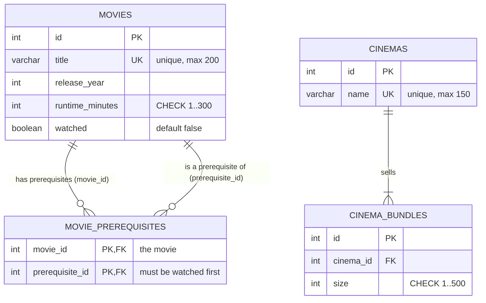
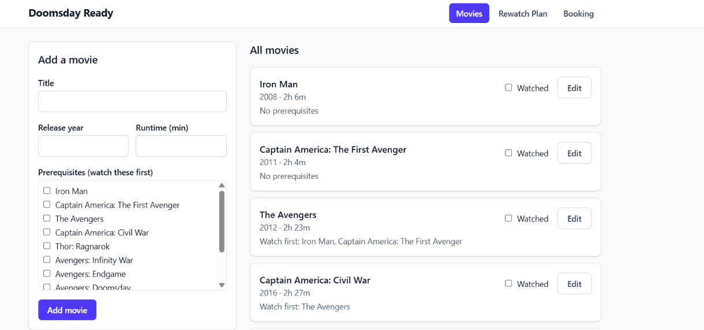

# Doomsday Ready

A small full-stack app that helps MCU fans plan their rewatch before *Avengers: Doomsday* and book an opening-night watch party.

Built for the **Blinto Talent Accelerator 2027 – Full Stack Developer Internship Assessment**.

| | |
|---|---|
| Live frontend | https://doomsday-ready-theta.vercel.app |
| Live backend (API base URL) | https://doomsday-ready-api.onrender.com/api |
| GitHub repository | https://github.com/shafikulnayem10/doomsday-ready |

> **Note on cold starts:** the backend runs on Render's free tier and sleeps after about 15 minutes without traffic. The first request after a pause can take around a minute. The database (Neon free tier) also suspends when idle and wakes up on the next query. If the frontend shows "Loading..." for a while on first visit, please wait or open the API URL once to wake it up.

---

## Table of contents

1. [Features](#features)
2. [Tech stack](#tech-stack)
3. [Architecture overview](#architecture-overview)
4. [Folder structure](#folder-structure)
5. [Data model (ER diagram)](#data-model-er-diagram)
6. [Local setup](#local-setup)
7. [Environment variables](#environment-variables)
8. [API documentation](#api-documentation)
9. [Testing with Thunder Client](#testing-with-thunder-client)
10. [Algorithms and design decisions](#algorithms-and-design-decisions)
11. [Assumptions and limitations](#assumptions-and-limitations)
12. [Problems faced and how they were solved](#problems-faced-and-how-they-were-solved)
13. [Deployment](#deployment)
14. [Screenshots](#screenshots)
15. [AI usage disclosure](#ai-usage-disclosure)

---

## Features

**Movies and rewatch order**
- Create movies with a unique title, release year, runtime (1–300 minutes), optional prerequisites and a watched flag (default `false`).
- Update any movie field, including watched status and prerequisites.
- Circular dependencies (direct or indirect) are rejected with `409 CIRCULAR_DEPENDENCY`; nothing is saved when this happens.
- Rewatch order for a target movie: every transitive prerequisite exactly once, prerequisites before the movies that depend on them, target excluded. The response also contains the number of watched prerequisites and the total runtime of the unwatched ones.

**Cinemas and watch-party booking**
- Create cinemas with a unique name and 1–10 distinct bundle sizes (each 1–500 seats).
- Booking quote: the fewest bundles that add up to *exactly* the group size (1–10,000), with the quantity of each bundle size, or a clear "Not Possible" result.

**Frontend (three views)**
- **Movies:** list, add, edit (including prerequisites), mark watched or unwatched.
- **Rewatch Plan:** pick a target movie and see the ordered list with watched ticks, a progress bar ("4 of 7 watched") and the remaining watch time.
- **Booking:** pick a cinema, enter a group size and see the bundles to buy or "Not possible".

## Tech stack

| Layer | Technology |
|---|---|
| Backend | NestJS, TypeScript (ESM), REST API |
| Database | PostgreSQL, TypeORM |
| Validation | class-validator, class-transformer, `@nestjs/config` |
| Frontend | Next.js (App Router), React, TypeScript, Tailwind CSS |
| API testing | Thunder Client (VS Code), manual |
| Hosting | Render (backend), Neon (PostgreSQL), Vercel (frontend) |

## Architecture overview

```
Browser (Next.js on Vercel)
        |  HTTPS, JSON
        v
NestJS REST API (Render)  --->  PostgreSQL (Neon)
  Controller -> Service -> TypeORM repository
                   |
                   +-> pure algorithm functions (no database, no libraries)
```

- **Controllers** only handle HTTP (routes, params, DTOs).
- **Services** hold the business logic and talk to the database through TypeORM repositories.
- **Algorithms** live in plain TypeScript functions (`prerequisite-graph.ts`, `min-bundles.ts`) that take data in and return results, so they are easy to read and test without a database.
- A global exception filter turns every error into the same JSON shape (see [API documentation](#api-documentation)).
- A global `ValidationPipe` validates every request body and query using DTO classes.

## Folder structure

```
doomsday-ready/
├── backend/
│   ├── .env.example
│   └── src/
│       ├── main.ts                      # global prefix /api, validation, filter, CORS
│       ├── app.module.ts
│       ├── common/filters/all-exceptions.filter.ts
│       ├── database/database.module.ts  # TypeORM connection from environment variables
│       ├── migrations/                  # schema migration used in production
│       ├── movies/
│       │   ├── entities/movie.entity.ts
│       │   ├── dto/                     # create / update DTOs
│       │   ├── algorithms/prerequisite-graph.ts   # rewatch order + cycle detection
│       │   ├── movies.service.ts
│       │   ├── movies.controller.ts
│       │   └── movies.module.ts
│       └── cinemas/
│           ├── entities/                # cinema.entity.ts, cinema-bundle.entity.ts
│           ├── dto/                     # create cinema, booking query
│           ├── algorithms/min-bundles.ts          # minimum-bundle dynamic programming
│           ├── cinemas.service.ts
│           ├── cinemas.controller.ts
│           └── cinemas.module.ts
├── frontend/
│   ├── .env.example
│   └── src/
│       ├── app/                         # layout, /movies, /rewatch, /booking pages
│       ├── components/Nav.tsx
│       └── lib/                         # api.ts (API client + types), format.ts
└── README.md
```

## Data model (ER diagram)



Key constraints, enforced in the database as well as in the application:
- `movies.title` and `cinemas.name` are unique.
- `movies.runtime_minutes` must be between 1 and 300; `cinema_bundles.size` between 1 and 500.
- `movie_prerequisites` has a composite primary key `(movie_id, prerequisite_id)` so the same prerequisite cannot be stored twice, and a `CHECK (movie_id <> prerequisite_id)` that blocks a direct self-dependency (created by the production migration, see [Local setup](#local-setup)). This check is only a second line of defence; circular dependencies of any length are detected by the DFS algorithm before saving.
- `cinema_bundles` has `UNIQUE (cinema_id, size)`, so one cinema cannot have the same bundle size twice.

## Local setup

**Prerequisites:** Node.js (developed with v26; v24 is used on Render), npm, PostgreSQL, Git. pgAdmin 4 is handy for inspecting the database.

### 1. Clone and create the database

```bash
git clone https://github.com/shafikulnayem10/doomsday-ready.git
cd doomsday-ready
```

Create an empty PostgreSQL database named `doomsday_ready` (for example in pgAdmin 4).

### 2. Backend

```bash
cd backend
cp .env.example .env        # on Windows: copy .env.example .env
# edit .env and set DB_PASSWORD to your PostgreSQL password
npm install
npm run start:dev           # http://localhost:3000/api
```

With `DB_SYNCHRONIZE=true` (local development only) TypeORM creates the tables from the entities automatically.

> The `CHECK (movie_id <> prerequisite_id)` on the `movie_prerequisites` join table cannot be declared with a TypeORM decorator, so it is created by the production migration only. For local development you can add it once with:
>
> ```sql
> ALTER TABLE movie_prerequisites
> ADD CONSTRAINT no_self_prerequisite CHECK (movie_id <> prerequisite_id);
> ```
>
> The application rejects self-dependencies in any case (see [Algorithms](#algorithms-and-design-decisions)).

### 3. Frontend

```bash
cd frontend
cp .env.example .env.local  # NEXT_PUBLIC_API_URL=http://localhost:3000/api
npm install
npm run dev -- -p 3001      # http://localhost:3001
```

### Schema management

- **Local development:** `synchronize: true` (fast, builds the schema from the entities).
- **Production:** `synchronize` is **off**. The schema is created by a hand-written TypeORM migration (`backend/src/migrations`), which runs automatically at startup when `DB_MIGRATIONS_RUN=true`. This keeps the production schema under version control and avoids accidental schema changes. For future schema changes, add a new migration instead of editing the existing one.

## Environment variables

### Backend (`backend/.env`)

| Variable | Description |
|---|---|
| `PORT` | Server port (default `3000`; set automatically by Render) |
| `DB_HOST`, `DB_PORT`, `DB_USERNAME`, `DB_PASSWORD`, `DB_NAME` | Local PostgreSQL connection |
| `DATABASE_URL` | Single connection URL for hosted databases (overrides the `DB_*` variables) |
| `DB_SSL` | `true` for hosted databases that require SSL (Neon) |
| `DB_SYNCHRONIZE` | `true` for local development only; `false` in production |
| `DB_MIGRATIONS_RUN` | `true` to run pending migrations on startup (production) |
| `FRONTEND_URL` | Allowed browser origin(s) for CORS, comma-separated, no trailing slash. If unset, all origins are allowed (local development). |

### Frontend (`frontend/.env.local`)

| Variable | Description |
|---|---|
| `NEXT_PUBLIC_API_URL` | Base URL of the backend API, e.g. `http://localhost:3000/api` |

`.env` files are git-ignored; only the `.env.example` files with placeholder values are committed.

## API documentation

Base URL: `https://doomsday-ready-api.onrender.com/api` (local: `http://localhost:3000/api`). All bodies are JSON.

| Method | Endpoint | Purpose |
|---|---|---|
| POST | `/movies` | Create a movie |
| GET | `/movies` | List movies (with their prerequisites) |
| PATCH | `/movies/:id` | Update a movie, including `watched` and `prerequisiteIds` |
| GET | `/movies/:id/rewatch-order` | Rewatch order for a target movie |
| POST | `/cinemas` | Create a cinema |
| GET | `/cinemas` | List cinemas |
| GET | `/cinemas/:id/booking?groupSize=6` | Booking quote |

### Error format

Every error has the same shape:

```json
{ "statusCode": 409, "error": "CIRCULAR_DEPENDENCY", "message": "This change would create a circular dependency between movies" }
```

| Status | `error` | When |
|---|---|---|
| 400 | `VALIDATION_ERROR` | Invalid body or query (`message` is an array of problems), duplicate bundle sizes |
| 400 | `INVALID_PREREQUISITE` | A prerequisite id does not exist |
| 404 | `MOVIE_NOT_FOUND`, `CINEMA_NOT_FOUND` | Unknown id |
| 409 | `CIRCULAR_DEPENDENCY` | The change would create a dependency cycle (including a movie depending on itself) |
| 409 | `DUPLICATE_TITLE`, `DUPLICATE_CINEMA_NAME` | Unique value already exists |
| 500 | `INTERNAL_SERVER_ERROR` | Unexpected error (details are not exposed) |

### `POST /movies`

Request:

```json
{
  "title": "The Avengers",
  "releaseYear": 2012,
  "runtimeMinutes": 143,
  "prerequisiteIds": [1, 2],
  "watched": false
}
```

`prerequisiteIds` and `watched` are optional. Response `201`:

```json
{
  "id": 3,
  "title": "The Avengers",
  "releaseYear": 2012,
  "runtimeMinutes": 143,
  "watched": false,
  "prerequisites": [
    { "id": 1, "title": "Iron Man", "releaseYear": 2008, "runtimeMinutes": 126, "watched": false },
    { "id": 2, "title": "Captain America: The First Avenger", "releaseYear": 2011, "runtimeMinutes": 124, "watched": false }
  ]
}
```

### `PATCH /movies/:id`

All fields are optional. `prerequisiteIds` **replaces** the whole prerequisite list (`[]` removes all; omitting it leaves them unchanged).

```json
{ "watched": true }
```

```json
{ "prerequisiteIds": [1, 2] }
```

Making *Avengers: Endgame* (id 7) a prerequisite of *Iron Man* (id 1) fails:

```
PATCH /api/movies/1   { "prerequisiteIds": [7] }
-> 409 { "statusCode": 409, "error": "CIRCULAR_DEPENDENCY", "message": "This change would create a circular dependency between movies" }
```

### `GET /movies/:id/rewatch-order`

Example for *Captain America: Civil War* (id 4) when *Iron Man* is already watched:

```json
{
  "target": { "id": 4, "title": "Captain America: Civil War" },
  "order": [
    { "id": 1, "title": "Iron Man", "releaseYear": 2008, "runtimeMinutes": 126, "watched": true },
    { "id": 2, "title": "Captain America: The First Avenger", "releaseYear": 2011, "runtimeMinutes": 124, "watched": false },
    { "id": 3, "title": "The Avengers", "releaseYear": 2012, "runtimeMinutes": 143, "watched": false }
  ],
  "totalPrerequisites": 3,
  "watchedCount": 1,
  "remainingRuntimeMinutes": 267
}
```

A movie without prerequisites (for example *Thor: Ragnarok*) returns `"order": []`, `"totalPrerequisites": 0`.

### `POST /cinemas`

```json
{ "name": "Cinema B", "bundleSizes": [2, 5] }
```

Response `201`:

```json
{ "id": 2, "name": "Cinema B", "bundleSizes": [2, 5] }
```

### `GET /cinemas/:id/booking?groupSize=11`

```json
{
  "cinema": { "id": 2, "name": "Cinema B" },
  "groupSize": 11,
  "bundleSizes": [2, 5],
  "possible": true,
  "totalBundles": 4,
  "bundles": [
    { "size": 5, "quantity": 1 },
    { "size": 2, "quantity": 3 }
  ]
}
```

When no exact combination exists (bundles 4 and 6, group of 7) the response is still `200`:

```json
{
  "cinema": { "id": 4, "name": "Cinema D" },
  "groupSize": 7,
  "bundleSizes": [4, 6],
  "possible": false,
  "totalBundles": 0,
  "bundles": [],
  "message": "Not Possible"
}
```

## Testing with Thunder Client

The API was tested manually with the [Thunder Client](https://www.thunderclient.com/) VS Code extension. The exported collection is in [`docs/thunder-client-collection.json`](docs/thunder-client-collection.json).

1. In Thunder Client choose **Collections → Import** and select the file.
2. Create an environment variable `baseUrl` = `http://localhost:3000/api` (or the live URL above).
3. On an empty database run **Create Movie** requests 1 to 8 in order (ids become 1–8), then **Create Cinema A–D** (ids 1–4).

Cases covered by the collection:

| Area | Cases |
|---|---|
| Rewatch order | Doomsday (all 7 prerequisites, valid order), Civil War (Iron Man and The First Avenger, then The Avengers), Thor: Ragnarok (empty list), target movie excluded, watched count and remaining runtime after marking a movie watched |
| Circular dependency | Making a late movie a prerequisite of Iron Man (indirect cycle), movie as its own prerequisite (direct), both `409 CIRCULAR_DEPENDENCY` |
| Movie validation | Duplicate title, runtime 301, non-existent prerequisite id, unknown movie id |
| Booking | Bundles 1,3,4 for 6 → 2 bundles (3 × 2); 2,5 for 11 → 4 bundles; 6,9,20 for 44 → 4 bundles; 4,6 for 7 → Not Possible; single-bundle and exact-multiple groups |
| Booking validation | `groupSize` 0 and 10001, unknown cinema id, duplicate bundle sizes, duplicate cinema name |

There is no automated test suite for the algorithms; testing was manual.

## Algorithms and design decisions

Both core algorithms are implemented in plain TypeScript, without any library that solves these problems.

### Algorithm research and verification

Before settling on the rewatch-order approach, I studied and simulated both Breadth-First Search (BFS) and Depth-First Search (DFS) on paper for the prerequisite graph. I then discussed the options with Claude, and DFS with post-order traversal was recommended. After that I did a second paper simulation to verify the traversal order and to confirm that prerequisites always appear before the movies that depend on them. The TypeScript code of the algorithms was written by Claude (see the [AI usage disclosure](#ai-usage-disclosure)); I used the same paper-simulation approach to understand and verify the cycle-detection logic before it was integrated into the backend.

### Rewatch order: Graph + DFS post-order (`backend/src/movies/algorithms/prerequisite-graph.ts`)

Movies are the nodes of a directed graph; an edge goes from a movie to each of its direct prerequisites. The graph is held in memory as `Map<movieId, prerequisiteIds[]>`.

- A depth-first search starts at the target movie. For each movie it first visits all of its prerequisites and only **then** appends the movie itself to the result (post-order).
- Therefore every prerequisite is added before any movie that depends on it, which is a valid topological order.
- A `visited` set ensures each movie is processed once, even when it can be reached through several paths (for example *Iron Man* through *The Avengers* only).
- The target is always appended last, so it is removed at the end.
- Complexity: O(V + E) time, O(V) space.

### Circular dependency detection: DFS with a "visiting" state (same file)

Before a movie's prerequisites are changed, the new prerequisite list is applied to an in-memory copy of the graph and a DFS runs from the changed movie. Each node is `unvisited`, `visiting` (on the current path) or `done`. Reaching a node that is still `visiting` means the path came back to itself, i.e. there is a cycle. Any new cycle must pass through the changed movie, so starting there is enough. This catches direct (`A -> A`) and indirect (`A -> B -> C -> A`) cycles. If a cycle is found the request fails with `409 CIRCULAR_DEPENDENCY` **before** anything is written to the database.

A newly created movie cannot be anyone's prerequisite yet, so creating a movie cannot form a cycle; invalid prerequisite ids are rejected with `400 INVALID_PREREQUISITE`.

### Booking: Dynamic Programming, minimum coin change (`backend/src/cinemas/algorithms/min-bundles.ts`)

Bundles are "coins" and the group size is the "amount".

- `minCount[x]` is the fewest bundles that sum to exactly `x` seats (`Infinity` if impossible); `minCount[0] = 0`.
- For every `x` from 1 to the group size, try each bundle size `s <= x` and keep the best value of `minCount[x - s] + 1`, remembering the bundle used in `lastUsed[x]`.
- If `minCount[groupSize]` is still `Infinity`, the result is "Not Possible". Otherwise, walk back from `groupSize` using `lastUsed` and count how many times each size was used.
- Complexity: O(groupSize × bundleCount) time (at most 10,000 × 10), O(groupSize) space.

### Other decisions

- **Separate `cinema_bundles` table** (instead of an array column) so uniqueness and the size range are enforced by database constraints and the model is easy to show in the ER diagram.
- **Self-referencing many-to-many** (`movie_prerequisites`) for prerequisites.
- **Consistent error shape** through a global exception filter, plus a safety net for database unique-constraint violations.
- **Validation at the edge** with DTOs (`whitelist` and `forbidNonWhitelisted`), so unknown fields are rejected.
- **No authentication, payments or delete endpoints:** not required by the assessment, so not added.

## Assumptions and limitations

- Where the assessment was unclear I made the choices below.
  - One movie or cinema is created per `POST` request.
  - Prerequisites are sent as `prerequisiteIds: number[]` (movie ids), and `PATCH` replaces the whole list.
  - Release year must be between 1888 and 2100 (validated separately from the 1–300 minute runtime rule).
  - Titles and cinema names are trimmed and compared exactly (case-sensitive).
  - A cinema with duplicate bundle sizes is rejected with `400` (not silently de-duplicated).
  - An impossible booking returns HTTP `200` with `"possible": false` and `"message": "Not Possible"`, because it is a valid answer rather than a client error.
- The sample movie runtimes (and the 150-minute runtime for *Avengers: Doomsday*) are illustrative values; the sample prerequisite links are the assessment's sample data, not an official watch guide.
- There is no endpoint to delete movies or cinemas, or to edit a cinema; cinemas are created through the API only (the frontend has no cinema form).
- Free-tier hosting: the backend sleeps when idle (about one minute to wake up) and the Neon database suspends when idle.
- Rewatch order and cycle checks load all movies into memory; this is fine at this scale but would need a different approach for very large catalogues.
- No automated test suite; verification was manual (Thunder Client and the live frontend).
- Docker Compose (optional bonus in the assessment) was intentionally not used.

## Problems faced and how they were solved

1. **No `.gitignore` after scaffolding.** The Nest project was generated with `--skip-git` (the Git repository lives in the project root, not in `backend/`), so no `.gitignore` existed and `.env` could have been committed by accident.
   *Solution:* created one `.gitignore` in the repository root (ignores `node_modules`, build output and `.env*`, but keeps `.env.example`) and checked it with `git check-ignore -v` and `git status -u` before the first commit.

2. **ESM project scaffold.** The generated NestJS project uses ES modules (and Vitest). In ESM, relative imports need a `.js` extension even in `.ts` files, and TypeORM entities that import each other (`Cinema` and `CinemaBundle`) can fail at startup with "before initialization" errors.
   *Solution:* every relative import ends in `.js`, and the two-way relation is typed with TypeORM's `Relation<>` wrapper to avoid the circular-import problem.

3. **Self-dependency check on the join table.** Blocking `A -> A` in the database needs a `CHECK` constraint on the auto-generated `movie_prerequisites` table, which cannot be declared with a TypeORM decorator.
   *Solution:* the constraint is written as SQL in the production migration. It is only a second line of defence; the real protection is the DFS cycle check that runs before saving.

4. **Production schema management.** `synchronize: true` is unsafe in production, and Render's free web services have no shell to run migration commands by hand.
   *Solution:* a hand-written migration (`backend/src/migrations`) that runs automatically at startup when `DB_MIGRATIONS_RUN=true`, with `synchronize` turned off.

5. **Migration test showed no tables at first.** When I tested the migration on a fresh local database, pgAdmin showed no tables even though the server had started.
   *Solution:* stopped and restarted the server so that it picked up the changed `.env` (a running `nest start --watch` does not reload `.env`) and refreshed pgAdmin. After that the four tables and the `migrations` table were there. The migration files are found through a path pattern relative to the compiled `database.module.js`, and the same setup created the tables on the Neon database at the first deploy.

6. **Choosing free hosting.** According to Render's documentation (checked in November 2026), its free PostgreSQL database expires after 30 days, and free web services sleep when idle and have no shell.
   *Solution:* the database is on Neon (the free plan has no expiry), the backend on Render, the frontend on Vercel. The sleep behaviour could not be removed, so it is documented at the top of this README.

7. **Render form defaults.** The new web service form pre-selected a paid instance type and had empty build and start commands.
   *Solution:* switched to the Free instance, set the build command to `npm install --include=dev && npm run build` (the Nest CLI is a dev dependency) and the start command to `npm run start:prod`, and added the environment variables.

8. **Port clash and cross-origin calls.** Backend and frontend both default to port 3000 locally, and the deployed frontend (Vercel) calls the API on another domain (Render).
   *Solution:* the frontend runs on port 3001 locally; the backend enables CORS and, in production, only allows the origin set in `FRONTEND_URL`. The frontend API URL comes from `NEXT_PUBLIC_API_URL`, which Next.js bakes in at build time, so it is set before deploying.

9. **Dependency audit warnings (not fixed).** `npm install` in the backend reported 5 vulnerabilities. I did not run `npm audit fix --force` because it can apply breaking upgrades to the framework packages; these warnings remain to be reviewed.

## Deployment

| Part | Service | Notes |
|---|---|---|
| Database | Neon (PostgreSQL, free tier) | Singapore region, connection through `DATABASE_URL` with SSL |
| Backend | Render (free web service) | Root directory `backend`, build `npm install --include=dev && npm run build`, start `npm run start:prod`. Environment: `DATABASE_URL`, `DB_SSL=true`, `DB_SYNCHRONIZE=false`, `DB_MIGRATIONS_RUN=true`, `NODE_VERSION`, `FRONTEND_URL` |
| Frontend | Vercel (Hobby) | Root directory `frontend`, environment: `NEXT_PUBLIC_API_URL` |

On first start the backend runs the migration, which creates all tables.

## Screenshots

| Movies | Rewatch Plan | Booking |
|---|---|---|
|  |  |  |

## AI usage disclosure

I used **Claude (Anthropic)** as a coding assistant and tutor throughout this project, and the work is **not** entirely written independently.

- **Planning and design:** Claude helped analyse the requirements, propose the architecture, the database schema and the choice of algorithms; I made the decisions between the options it presented (for example the separate `cinema_bundles` table, migrations for production, and the hosting providers).
- **Code:** Claude wrote the first version of the backend (NestJS modules, entities, DTOs, services and controllers), including the two core algorithms (rewatch order with cycle detection, and minimum bundle calculation), the production migration, and the frontend (Next.js pages and API client). I created the files in my own project, ran the code, and fixed or adjusted things as I went.
- **Learning:** Claude explained the algorithms (graph, DFS, topological ordering, dynamic programming) with dry runs on sample input.
- **Testing and deployment:** I ran and tested the API manually with Thunder Client, tested the frontend, and performed the deployments on Neon, Render and Vercel, following step-by-step instructions from Claude.
- **README:** Claude drafted this document; I reviewed it against the running application.

No external library is used to solve the rewatch-order or booking problems.